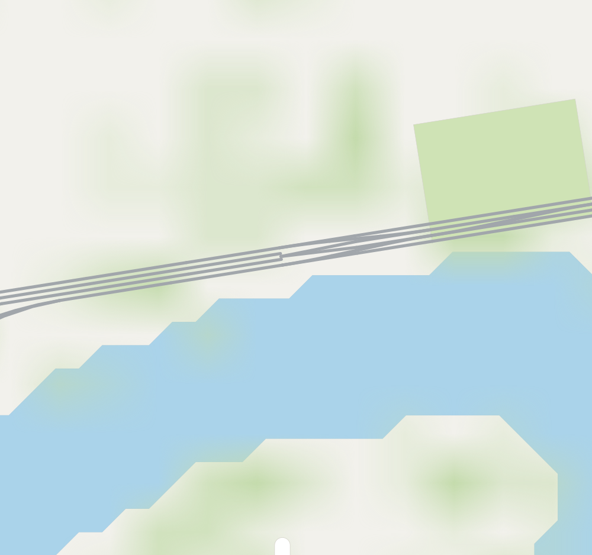
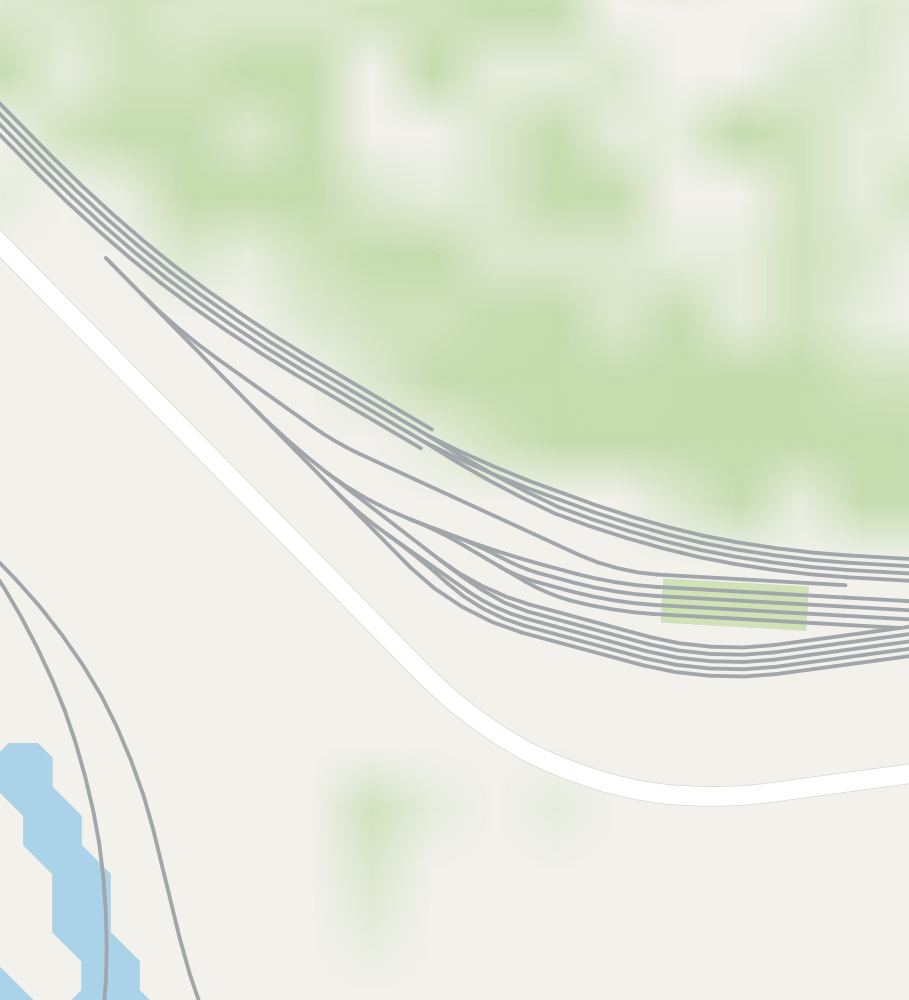
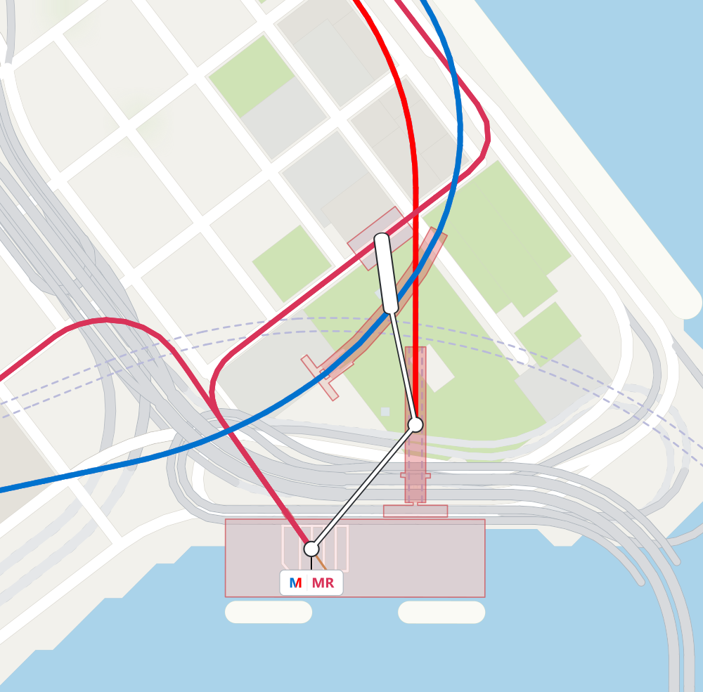
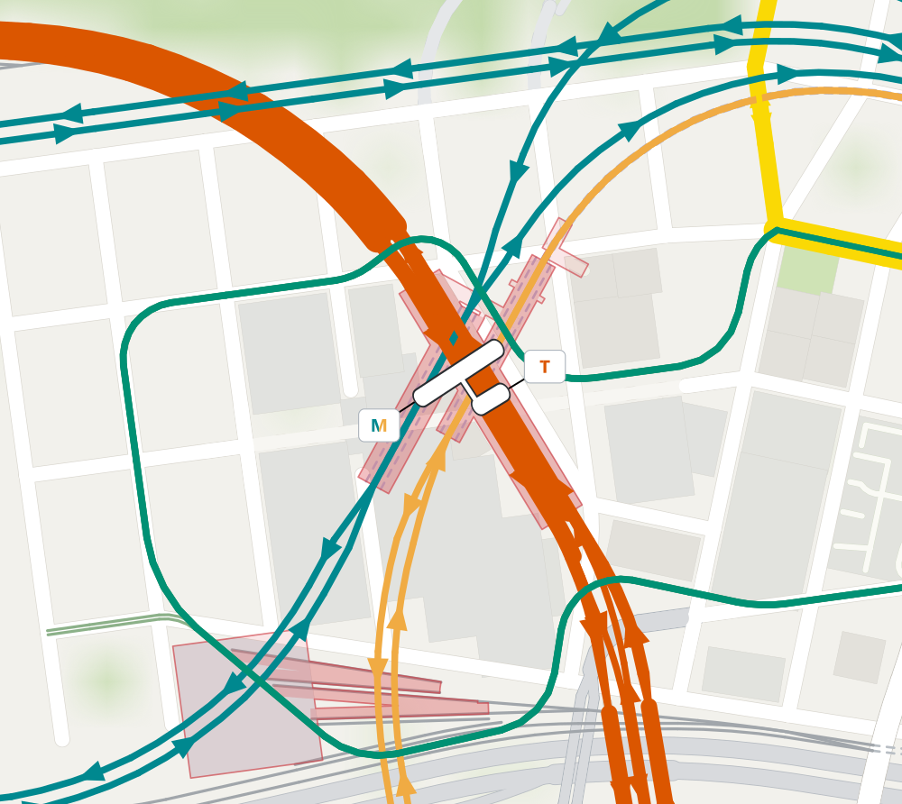
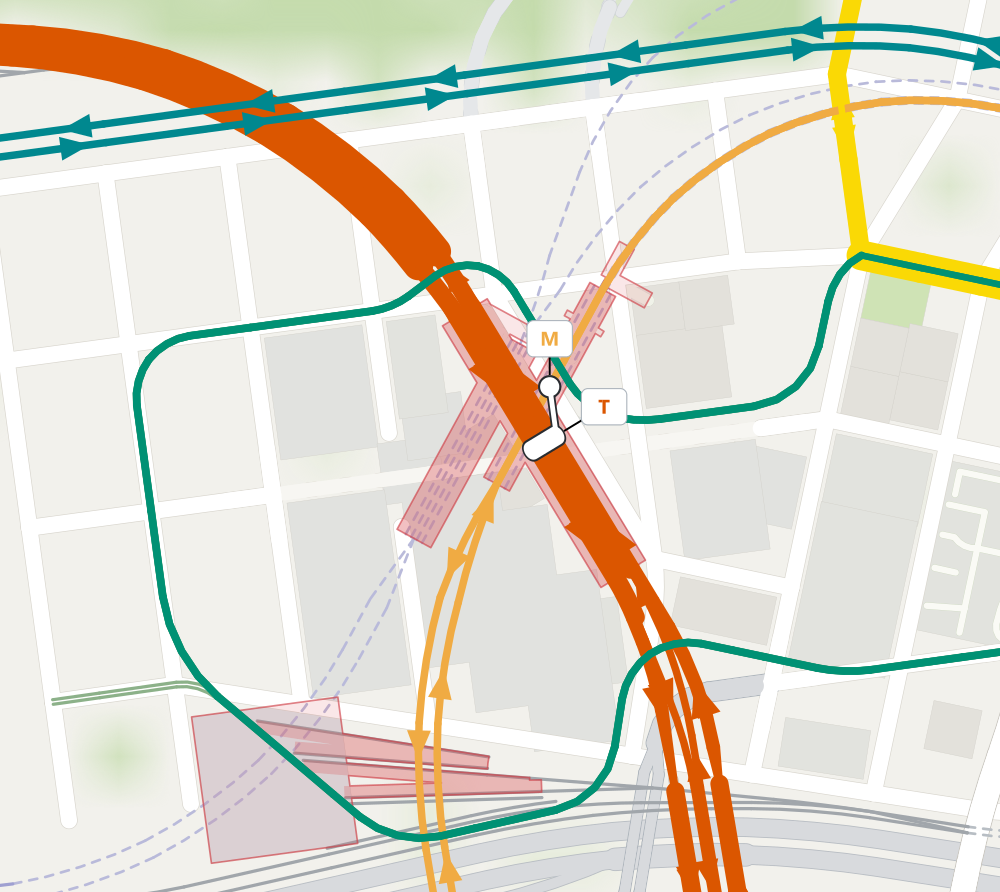

<!-- Writing reference: ASD-STE100, Issue 9. https://www.asd-ste100.org/assets/files/ASD-STE100_ISSUE9.pdf -->

# CS1MapView

CS1MapView is a Windows map viewer for Cities: Skylines 1 exports.
The viewer opens `.cslmap` and `.cslmap.gz` files.
It does not open `.crp` files or Cities: Skylines 2 exports.

## Development and credits

CS1MapView is developed entirely through prompts to GPT-6 Astra and GPT-6.1 Sol.
The design is based on gansaku's original [CSLMapView](https://steamcommunity.com/sharedfiles/filedetails/?id=845665815).
The source code is based on gansaku's [CS2MapView](https://github.com/gansaku/CS2MapView).
We thank gansaku for the original projects.
The partial Japanese interface is inherited from CS2MapView; its original Japanese resource files are included unchanged.
The Simplified and Traditional Chinese translations were generated by DeepSeek V4.1 Flash.
The upstream copyright notice and MIT license are included.

See the [development declaration](DEVELOPMENT.md).

[](assets/images/routes-split-badges-rail-station-area-v2.svg)

## Glossary

Game networks are made of nodes and segments.
This structure applies to railways, roads, pedestrian networks, and other network types.

| Term | Meaning |
| --- | --- |
| Network | A game structure made of connected nodes and segments. |
| Node | An endpoint of a segment. Connected segments meet at a shared node. |
| Segment | A network connection with exactly two nodes: its start node and its end node. It can contain multiple tracks, lanes, or pedestrian paths. |
| Exported lane | A game metadata entry describing a way within a segment, including its mode, position, and allowed directions. The viewer uses this data to locate physical tracks and lanes. |
| Transit line or service | A service with an ordered sequence of stops and a route through the network. |
| Route path | The ordered geometry followed by a transit service. It can pass through many network segments. |
| Station marker | A circle or elongated symbol representing one physical stop position or a cluster of aligned stops. |
| Transit modal tag | A label connected to a station marker by a leader. It shows serving modes and line colors, or explicit line shorthands. |

Use the mode-specific name for the ways within a segment: **railway tracks**,
**metro tracks**, **tram tracks**, **road lanes**, **cycle lanes**, or **pedestrian paths**.
A segment can contain ways for more than one mode, such as road lanes and tram tracks.

A **quad-track railway segment** contains four railway tracks and still has only
two endpoint nodes. Where it joins other segments, those segments meet at the
shared node. Track count and segment count are separate quantities.
A railway track that carries trains in both directions remains one physical track.

## Terrain appearance

**Hillshading** adds soft relief from the exported terrain elevations.
It is off by default. Turn it on under **View > Layers and labels > Terrain appearance**,
or in the **Terrain** section of Options. The strength is adjustable from 0 to 100 percent;
82 percent matches the initial preview. Land colours stay in the selected map style.
Water, coastlines, roads, railways, and labels retain their existing appearance.

**Show contour lines** is a separate option. Use shading, contour lines, both, or neither.
Choose a contour detail preset in Options or **View > Layers and labels > Terrain appearance > Contour detail**:

- **A — Fine olive:** 25 m detail with gentle smoothing and fine olive strokes.
- **B — Balanced warm gray:** 25 m detail with rounder curves and stronger warm-gray strokes. Initial selection.
- **C — Sparse neutral:** 50 m spacing, stronger smoothing and fewer small loops.

Major contours are stronger every 100 m. A and B use 50 m spacing above 500 m.
The contour checkbox switches lines off without losing the selected preset.
Both options are saved and apply to the screen and exported maps, including raster terrain.
The terrain grid limits the detail visible at close zoom levels.

## Station areas

The station area layer shows building lots, station tracks, platform networks, and underground pedestrian networks.
The layer includes some BM station tracks and pathways.
Station areas have a red or blue fill.
The four supported BM underground station layouts use a stronger tint only on their platform projections, following the exported pedestrian path offsets and widths. Paired paths on a center platform are joined into one continuous platform area. Tracks and passages retain the lighter station tint.
Station areas are approximate 2D shapes.

| Station areas | Station areas and tracks |
| --- | --- |
|  |  |

Limits:

- The layer does not show platforms that are only part of building meshes.
- The layer does not include all custom platform or pathway assets.
- Areas at different heights can have an overlap on the map.
- The layer does not include airport or tram station buildings.
- The layer does not include building groups with `yard` or `depot` in their names.
- The map does not show if passengers can use each passage.

## Rail tracks

Railway, metro, and tram tracks use exported lane positions.
With **Separate tracks** enabled, each distinct physical track position has one map line.
A lane that carries trains in both directions still has one line.
Different segments along a network can contain different numbers of tracks.
At a splitting junction, the incident segments connect at a shared node.
The Apple style uses continuous track lines.
The Google style adds cross-ties.
Underground tracks use dashed lines.
Monorail and cable car tracks use one centerline.

The **Infrastructure only** option hides route lines and station markers.
**Reconnect tracks does not work yet.**
The option does not currently repair the gaps or mismatched endpoints at splitting junctions.

Limits:

- Each line shows one physical track, not its two steel rails.
- The viewer shows one centerline when lane data is missing.
- Switch geometry is approximate.

These exports show the current track geometry around splitting junctions.
Separate tracks is on and Reconnect tracks is off.

| Two-track and single-track railway segments at a junction node | Quad-track railway segment and two-track branches |
| --- | --- |
|  |  |

The first crop includes a parallel two-track network.
The quad-track railway segment in the second crop is at the upper left.
The gaps at some endpoints show the current junction limitation.
See the [track-count examples](assets/images/track-count-examples/README.md) for lane positions and export settings.

## Supported Workshop assets

The viewer recognizes the exported geometry of the following asset groups.
The table gives selected examples present in the reference city export.
Workshop names and links were checked on 2026-10-13.

Support refers to 2D map display.
The viewer uses lane positions, network widths, and building lots from the export.
It does not display vehicle models, props, or platforms that exist only in building meshes.
Other assets can work when their exports contain the same usable metadata.

| Asset group and Workshop examples | Map display |
| --- | --- |
| RAILWAY 2 American Wooden: [network pack](https://steamcommunity.com/sharedfiles/filedetails/?id=2610252544), [wireless](https://steamcommunity.com/sharedfiles/filedetails/?id=2619651082), [mainline](https://steamcommunity.com/sharedfiles/filedetails/?id=2610254154), [Northeast Corridor](https://steamcommunity.com/sharedfiles/filedetails/?id=2610255329) | Separate railway tracks from exported lane positions, including railway segments containing one, two, or four tracks. |
| RAILWAY 2 American Concrete: [network pack](https://steamcommunity.com/sharedfiles/filedetails/?id=2610275913), [mainline](https://steamcommunity.com/sharedfiles/filedetails/?id=2610277041), [Northeast Corridor](https://steamcommunity.com/sharedfiles/filedetails/?id=2610277961), [Dynamic procedural pack](https://steamcommunity.com/sharedfiles/filedetails/?id=2812203991) | Separate railway tracks, including asymmetric and wider lane arrangements. |
| RAILWAY 2 station tracks: Wooden [ground](https://steamcommunity.com/sharedfiles/filedetails/?id=2610256766), [low](https://steamcommunity.com/sharedfiles/filedetails/?id=2610257966), and [standard](https://steamcommunity.com/sharedfiles/filedetails/?id=2610265253) entry; Concrete [standard](https://steamcommunity.com/sharedfiles/filedetails/?id=2610283286), [high](https://steamcommunity.com/sharedfiles/filedetails/?id=2721998933), [high island](https://steamcommunity.com/sharedfiles/filedetails/?id=2722005927), and [Dynamic dual islands](https://steamcommunity.com/sharedfiles/filedetails/?id=2815362291) | Railway tracks at their exported spacing. Tracks carrying stops can also have station areas. |
| Railway and RAILWAY 2 bridges: [Piacenza wireless](https://steamcommunity.com/sharedfiles/filedetails/?id=1574935847), [Stone Arch Overpasses](https://steamcommunity.com/sharedfiles/filedetails/?id=2112363592), [Urban Overpasses](https://steamcommunity.com/sharedfiles/filedetails/?id=2786565452), [NEC Portal North](https://steamcommunity.com/sharedfiles/filedetails/?id=2819280719), [Raritan River](https://steamcommunity.com/sharedfiles/filedetails/?id=2625686836), [Through Girder Pack 1](https://steamcommunity.com/sharedfiles/filedetails/?id=2926036331), [Railroad Crossing Variants](https://steamcommunity.com/sharedfiles/filedetails/?id=2786915325) | Physical railway tracks through bridge, overpass, and crossing networks. Bridge meshes and exact switch layouts are not shown. |
| RAILWAY 2 [Rail/Industrial Yard Networks](https://steamcommunity.com/sharedfiles/filedetails/?id=2918422869) and [24 cm variant](https://steamcommunity.com/sharedfiles/filedetails/?id=2919967634) | Physical tracks. Yard and depot building lots are excluded from station areas. |
| BVU Gravel Wooden Metro Tracks: [wired](https://steamcommunity.com/sharedfiles/filedetails/?id=2071010264), [third rail](https://steamcommunity.com/sharedfiles/filedetails/?id=2071006080); Station Tracks: [wired](https://steamcommunity.com/sharedfiles/filedetails/?id=2071009159), [third rail](https://steamcommunity.com/sharedfiles/filedetails/?id=2071005091) | Separate metro tracks. Tracks carrying stops can also have station areas. |
| BM underground station tracks: [Double #01](https://steamcommunity.com/sharedfiles/filedetails/?id=2463160214), [Center Platform #01](https://steamcommunity.com/sharedfiles/filedetails/?id=2469645459), [Bypass #01](https://steamcommunity.com/sharedfiles/filedetails/?id=2621140416), [4 L #01](https://steamcommunity.com/sharedfiles/filedetails/?id=2908783312) | Metro tracks and station areas, including unused recognized station-track segments. Stronger tint follows the pedestrian platform widths, with paired center-platform paths joined. |
| BM Station Pathways [#01](https://steamcommunity.com/sharedfiles/filedetails/?id=2372093501), [#02](https://steamcommunity.com/sharedfiles/filedetails/?id=2372093901), [#03](https://steamcommunity.com/sharedfiles/filedetails/?id=2372094372), [#04](https://steamcommunity.com/sharedfiles/filedetails/?id=2372094811), [#05](https://steamcommunity.com/sharedfiles/filedetails/?id=2372095863), and [Station Pathways #06 / #07](https://steamcommunity.com/sharedfiles/filedetails/?id=2870803975) | Passage areas associated with nearby stations or entrances. Pathway #05 is recognized even without exported lanes. |
| [North American Platforms (network pack)](https://steamcommunity.com/sharedfiles/filedetails/?id=2740493387) | Decorative platform areas using exported network widths. The reference export contains 19 platform variants from this pack. |
| BM [Entrance Buildings #01 (Right)](https://steamcommunity.com/sharedfiles/filedetails/?id=2463321976) and [Entrance Buildings #02](https://steamcommunity.com/sharedfiles/filedetails/?id=2870843227); FTP station anchors: [Double #01](https://steamcommunity.com/sharedfiles/filedetails/?id=2463308917), [Center #01](https://steamcommunity.com/sharedfiles/filedetails/?id=2469724915), [Bypass #01](https://steamcommunity.com/sharedfiles/filedetails/?id=2621162431), [4 Tracks #01](https://steamcommunity.com/sharedfiles/filedetails/?id=2908904669) | Surface entrance lots and nearby passage associations. Small invisible FTP anchors do not add station-lot rectangles. |
| LRT tram tracks: [standard](https://steamcommunity.com/sharedfiles/filedetails/?id=1554363713), [single tracks](https://steamcommunity.com/sharedfiles/filedetails/?id=1559078925), [without fences](https://steamcommunity.com/sharedfiles/filedetails/?id=1707061991); station tracks: [#01](https://steamcommunity.com/sharedfiles/filedetails/?id=1564758436), [Elevated #01](https://steamcommunity.com/sharedfiles/filedetails/?id=2809013500) | Separate physical tram tracks. Tram station-track areas are excluded from the station area layer. |


## Station clusters and transfer links

A station cluster is a group of aligned physical stops.
The viewer shows a cluster with two or more positions as one long station marker.
Other stops have circular station markers.

The viewer searches a circle around each visible physical stop.
The search includes pairs and larger groups.
One circle can contain more than one cluster.
Each stop is in one cluster.

Opposite-direction stop pairs on the same line have the first priority.
Stops with the same transport mode have the next priority.
The viewer then selects the smallest number of markers and the shortest total marker length.
The viewer calculates travel directions from the exported outgoing service paths.

The alignment limit is the maximum perpendicular distance between a stop and the fitted cluster axis.
The viewer uses the largest applicable alignment limit.

| Cluster members | Alignment limit |
| --- | --- |
| Different transport modes | 5 m |
| One transport mode | 6 m |
| One transport mode, a line common to all stops, and an opposite-direction pair | 7 m |

The selected transport modes control which stops can have a transfer link.
The distance limit uses the physical stop positions.
The viewer measures link length between the nearest points on the marker axes.
The viewer keeps the shortest links that keep each reachable group connected.
The links can have branches, but have no loops.
The viewer shows a maximum of one link for each marker pair.

Route stop data does not change.

| Setting | Function | Default |
| --- | --- | --- |
| Cluster search radius | Sets the radius of each search circle. | 90 m |
| Transfer link distance | Sets the maximum distance between stops for a link. | 100 m |

Marker width does not change these distances.
The viewer saves the two distance settings.
The feature gallery uses a 90 m cluster search radius and a 150 m transfer link distance.

Limits:

- Stops without direction data do not receive the opposite-direction priority.
- Clusters use 2D stop positions. Station area boundaries do not control clusters.
- Transfers beyond the distance limit do not have direct links.
- Links do not show walking paths or fare rules.

The examples below show the same map area with different distance settings.
The green circle shows the cluster search radius for stop A.
The purple circle shows the transfer link distance from stop A.
The top image pair changes the cluster radius.
The bottom image pair changes the link distance.

[](assets/images/distance-examples/distance-comparison.svg)

See the [distance examples](assets/images/distance-examples/README.md) for individual images and export settings.

The next examples show the alignment test and the selection priorities.
The bands show the alignment limits around the fitted axes.
The blue arrows show outgoing travel directions.
The white station markers show the viewer results.

[](assets/images/station-rule-examples/station-rule-comparison.svg)

See the [station rule examples](assets/images/station-rule-examples/README.md) for individual images and measurements.

## Transit modal tags

Transit modal tags show serving modes, line colors, and short line names.
Mode letters are optional: `T` for train, `M` for metro, and `MR` for monorail.
Leaders connect transit modal tags to station markers.
Leaders stop at the edges of the modal tags and markers.

| "One transit modal tag per cluster" | Result |
| --- | --- |
| On | Each station cluster has one transit modal tag, containing only its serving lines. |
| Off | Each local transfer group has one combined transit modal tag. |

| One transit modal tag for each transfer group | One transit modal tag for each station cluster |
| --- | --- |
|  |  |

## Layer and line controls

Route lines, station markers with transit modal tags, tracks, and station areas have different layer switches.
Station clusters and transfer links do not include hidden lines.
The route layer switch does not remove station markers.
Train route lines can stay visible without train markers.

| Route lines off | Route lines on |
| --- | --- |
|  |  |

| The two metro lines | Orange metro line hidden |
| --- | --- |
|  |  |

| Teal metro line hidden | The two metro lines, train markers hidden |
| --- | --- |
|  |  |

## Other features

- The `apple-light` style sets the map colors.
- The viewer uses exported road widths.
- Road widths use defaults when export data is missing.
- The editors change line colors, short line names, and building settings.
- The viewer exports PNG, JPEG, BMP, SVG, SVGZ, and 16-bit heightmaps.
- The command-line renderer exports maps without the application window.
- The Windows print dialog controls printer output.

The project has no printer test results.

## Build and start

Build requirements:

- Windows x64.
- .NET SDK 8 or a subsequent version with Windows desktop components.
- Network access for NuGet package downloads.

.NET Desktop Runtime 8 is necessary to start the viewer.

1. Build the viewer from the repository root.

   ```powershell
   ./build.ps1
   ```

2. Start the viewer.

   ```powershell
   ./src/CS2MapView.Form/bin/Release/net8.0-windows/CS1MapView.exe
   ```

Keep all files in the build output directory together.
Keep the dependency DLLs in `src/*/lib/`.

The **Options → Language** tab saves the interface language for the next launch.
Choose English, partial Japanese, Simplified Chinese or Traditional Chinese.
The Japanese text comes from gansaku's original CS2MapView form resources.
The Chinese catalogs were translated by DeepSeek V4.1 Flash, supplied by the user,
and retain their wording.
New, missing or stale translation entries use English fallback.
When no choice is saved, the viewer uses the Windows interface language if available,
or English otherwise. See the [localization guide](docs/localization.md) for language
selection, resource files and instructions for adding translations later.

## Map controls

| Task | Instruction |
| --- | --- |
| Open a map | Open a city export. |
| Pan | Drag the map. |
| Zoom | Turn the mouse wheel. |
| Turn the map | Hold Ctrl while you turn the mouse wheel. |
| Highlight transfers | Click a station marker, transit modal tag, or leader. |
| Clear the highlight | Press Escape. |

The **View** menu has the layer and style controls.
The **Lists** menu has the line and building editors.

## Checks and exports

The private reference export is necessary for the full checks.
See the [fixture requirements](samples/README.md).

```powershell
./build.ps1 -SmokeTest -MapFile 'C:/path/to/reference.cslmap.gz'
./scripts/render-map.ps1 -InputFile 'C:/path/to/city.cslmap.gz' -OutputFile 'renders/city.svg' -Style apple-light -Transit
```

See the [gallery settings](assets/images/README.md) for image crops and layer settings.
Private city exports and generated builds stay outside source control.

## Source and licenses

The repository includes the upstream MIT license and its original copyright notice.
Keep the licenses and notices with the source.

Internal `CS2MapView` names come from the upstream source.
Legacy `CSLMapView` names identify the export format and migration files.

- [Upstream MIT license](LICENSE.upstream).
- [Forms MIT license](src/CS2MapView.Form/LICENSE).
- [Dependency notices](NOTICES/).
